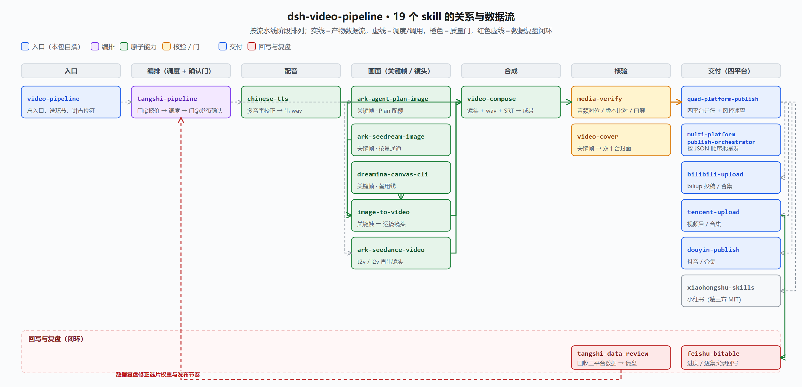

# video-pipeline-skills

一条**跑通过的短视频生产流水线**拆成的 19 个 skill：1 个总入口 + 1 个编排 + 17 个原子能力。做成宿主中立的 `SKILL.md` 形式，**Claude Code、Codex，以及任何支持 `SKILL.md` 的 agent 宿主都能用**。

覆盖：中文配音读音校正 → 文生图 / 文生视频 / 图片运镜 → 成片合成 → 封面 → 成片核验 → 多平台发布 → 数据复盘（闭环回选片权重）。



> 这条流水线上游是一个 DSH 插件（`dsh-video-pipeline`，已发布到 npm）。本仓是它的**下游分发**：同一套 skill 正文，改成宿主中立形式——占位符已落成可读值，不依赖 DSH 的插件机制。

## 安装

### 路线 1：Claude Code 插件（推荐）

本仓同时是一个 Claude Code **插件市场**（`.claude-plugin/marketplace.json`）与它唯一的插件（`.claude-plugin/plugin.json`）：

```sh
claude plugin marketplace add 439436269-ctrl/video-pipeline-skills
claude plugin install video-pipeline@video-pipeline-skills
```

在 Claude Code 会话里也可以直接用斜杠命令做同样的事：`/plugin marketplace add 439436269-ctrl/video-pipeline-skills` → `/plugin install video-pipeline@video-pipeline-skills`。

### 路线 2：把 skill 装进用户目录

```sh
node install.mjs --list                    # 先看会装哪些
node install.mjs --host claude --dry-run    # 只打印将做什么
node install.mjs --host claude              # 链接进 ~/.claude/skills（本机实测路径）
node install.mjs --host claude --copy       # 若不想用链接，复制一份快照
```

默认用**链接**（Windows junction / Unix symlink），以后 `git pull` 更新本仓即同步；`--force` 才覆盖同名且已存在的 skill。

### 路线 3：Codex

Codex 有 skills 机制，按 `user / repo / system / admin` 四类 scope 加载 `SKILL.md`（来自 `openai/codex` 源码的 `SkillScope` / `SkillMetadata`）。但**本仓未核实 user scope 的具体目录**，所以脚本不把它当事实：

```sh
node install.mjs --host codex --dest <你按官方文档确认过的目录>
```

官方文档：<https://developers.openai.com/codex/skills>。另外本仓根部的 `AGENTS.md` 是一份不需要安装的索引入口——Codex 读 `AGENTS.md` 就能知道这 19 个 skill 各管什么。

## 仓内结构

```
video-pipeline-skills/
├── .claude-plugin/
│   ├── marketplace.json      # 市场清单：本仓即市场，含一个插件
│   └── plugin.json           # 插件清单
├── skills/                   # 19 个 skill（由 tools/sync-skills.mjs 从上游生成）
├── docs/skill-flow.png       # 编排图（上游生成）
├── AGENTS.md                 # 给 agent 的索引入口（Codex / 通用）
├── install.mjs               # 装进宿主：链接或复制
└── tools/
    ├── sync-skills.mjs       # 从上游仓同步 skill（--check 比对漂移 / --write 写盘）
    └── verify-repo.mjs       # 本仓自检：两个清单 + 19 个 skill 结构
```

## 19 个 skill

`video-pipeline`（总入口）· `tangshi-pipeline`（编排）· `chinese-tts` · `ark-agent-plan-image` · `ark-seedream-image` · `ark-seedance-video` · `image-to-video` · `dreamina-canvas-cli` · `video-compose` · `video-cover` · `media-verify` · `tangshi-data-review` · `quad-platform-publish` · `multi-platform-publish-orchestrator` · `bilibili-upload` · `tencent-upload` · `douyin-publish` · `xiaohongshu-skills` · `feishu-bitable`

每个的职责、以及它们之间的交接，见 [`AGENTS.md`](AGENTS.md) 与各 skill 的 `SKILL.md`；上游仓 `docs/skill-flow.svg` 是这张图的矢量源。

## 前置依赖

本仓只有 skill（指令与脚本），**不安装任何工具**：

- **ffmpeg**：合成、运镜、核验。`xfade`/`ass`/`loudnorm` 等需要较新版本
- **Python 3** + `Pillow`：`scripts/` 下的 py 脚本（封面、图处理）
- **Node.js**：`scripts/` 下的 mjs 脚本；发布类 skill 需要时自行装 `playwright`
- **各平台凭据**：B 站 `biliup` 凭据、视频号/抖音/小红书登录态——必须你自己登录获取。**本仓不含任何凭据**

## 占位符

上游 DSH 插件会在加载 skill 时替换 `{{TOKEN}}` 形式的占位符；其他宿主没有这个机制，所以本仓在生成时**已经把它们落成可读值**，例如：

| 落成后的文本 | 含义 |
|---|---|
| `%USERPROFILE%` | 本机用户目录 |
| `<你的工作区>` | 工作区根目录 |
| `<飞书多维表格 base app_token>` / `<飞书数据表 table_id>` / `<飞书记录 record_id>` | 飞书坐标 |
| `<NAS 交付目录，如 /sata1/public/…>` / `<NAS 主机>` | NAS 位置 |
| `<设置环境变量 ARK_API_KEY>` / `<本地保存 ARK key 的文件>` | 火山方舟 key |

按需改成你自己的值即可（脚本里的那些要手改；skill 正文里的说明性占位符看懂就行）。

## 与上游的关系

skill 正文只在**上游仓**维护（那里有可复现导入器与隐私门）。本仓是生成物：

```sh
node tools/sync-skills.mjs --from <上游仓目录> --check   # 比对是否漂移（有漂移非零退出）
node tools/sync-skills.mjs --from <上游仓目录> --write   # 重新生成 skills/
node tools/verify-repo.mjs --claude                      # 自检两个清单 + 19 个 skill + claude validate
```

`verify-repo.mjs` 的存在有个实测原因：`claude plugin validate` 在仓根**只严格校验市场清单**，`plugin.json` 写坏了它只给 warning、**exit 仍是 0**（实测于 2026-10-12）。所以本仓自己做确定性断言，并把 claude 的 warning 也当失败。

## 许可与第三方代码

本仓 MIT。其中 `xiaohongshu-skills` 是第三方 MIT 代码（`white0dew/XiaohongshuSkills`），`douyin-publish` 改写自第三方 MIT 项目（`L1angjy/douyin-publish-skill`）——署名与许可全文见 [`THIRD-PARTY-NOTICES.md`](THIRD-PARTY-NOTICES.md)。上游发布前已剥离真实密钥、账号标识、个人路径与真实运营数据。
